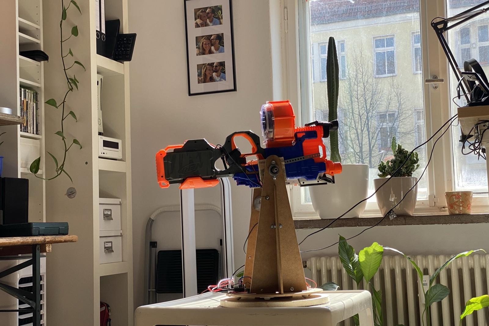
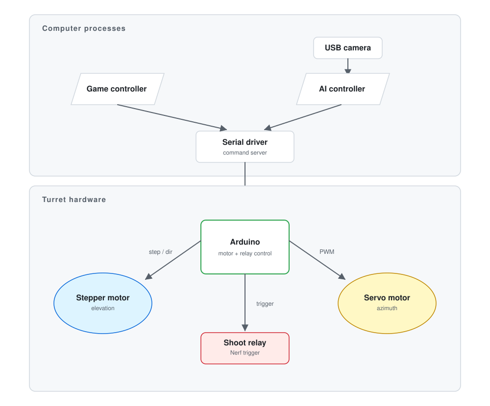
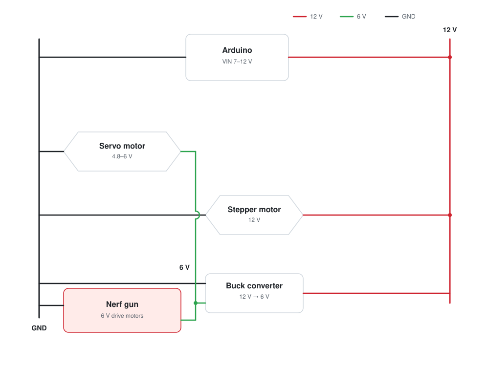
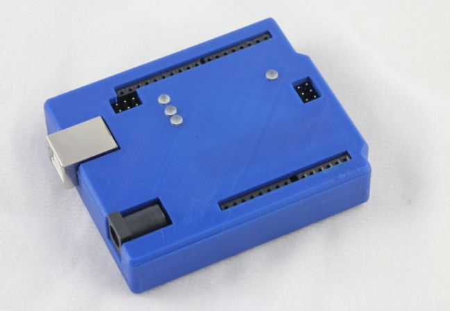
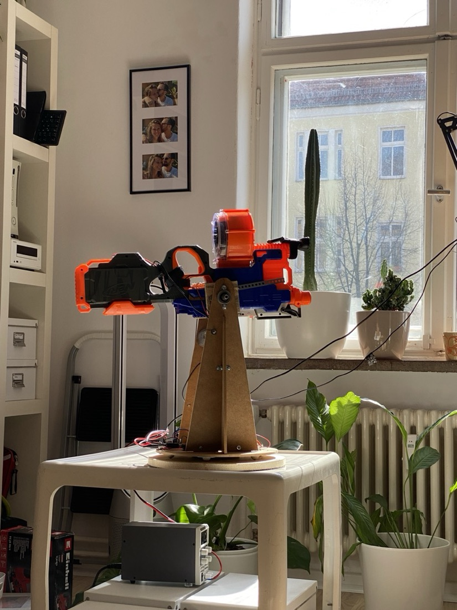
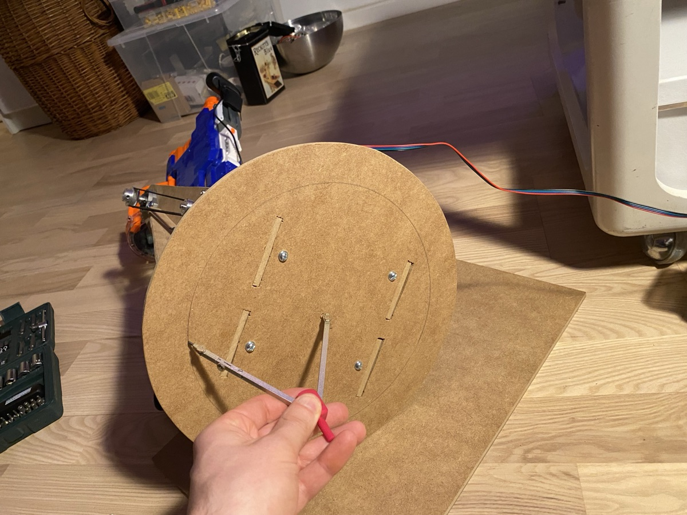

<div align="center">

# Autonomous Nerf Turret

**A camera-guided Nerf blaster that finds, tracks, and fires at targets on its own.**


</div>



## At a glance

The turret watches the room through a USB camera. A YOLOv8 and face-recognition pipeline decides what to aim at, a stepper motor handles elevation, a servo handles azimuth, and an Arduino pulls the trigger through a relay. A game controller can take over at any time.

- **Autonomous target tracking** — detects people, faces, or a chosen object class, then aims and fires.
- **On-device inference** — YOLOv8 segmentation and face recognition run locally; no cloud service required.
- **Two-axis aiming** — a NEMA 17 stepper for elevation and an SG90 servo for azimuth, driven by an Arduino.
- **Manual override** — plug in a game controller and drive the turret yourself through the same serial driver.
- **Tunable performance** — headless mode, frame skipping, and image compression let you trade latency for framerate on slower machines.

## How it works



1. **Camera** — frames are captured from a USB webcam.
2. **AI controller** (`components/ai_controller`) — runs detection and face recognition, picks a target, and produces aim and fire commands.
3. **Serial driver** (`components/serial_driver`) — a small command server that accepts JSON from any controller and forwards it over USB serial.
4. **Arduino** (`components/arduino`) — turns commands into step/direction pulses for the stepper, PWM for the servo, and a relay signal for the trigger.

A **game controller** can publish the same commands, which is useful for testing and for taking manual control.

## Power



- A single **12 V** supply feeds the Arduino VIN, the stepper driver, and the buck converter.
- The **12 V → 6 V buck converter** powers the servo and the Nerf gun drive motors.
- Every component shares a **common ground**.
- The A4988 current limit must be set before running the motor — see the [stepper motor notes](components/stepper_motor/README.md).

Measured current draw with the NEMA 17 stepper:

| State | Total circuit | Gun motors |
|-------|---------------|------------|
| Idle | 0.08 A | — |
| Running under full load | ~1.8 A | ~1.1 A |
| Startup peak | ~2.1 A | ~1.9 A |

## Hardware

| Part | Role | Notes |
|------|------|-------|
| Arduino Uno | Motor and relay control | Receives commands over USB serial |
| A4988 + NEMA 17 stepper | Elevation | 45 Ncm, 1.5 A, 12 V, 1.8° step angle |
| SG90 servo | Azimuth | 4.8–6 V |
| SRD-05VDC-SL-C relay | Fires the blaster | Triggered from Arduino digital pin 10 |
| 12 V → 6 V buck converter | Powers servo and gun motors | See the [power diagram](#power) |
| USB camera | Vision input | Used by the AI controller |
| Nerf Hyper-Fire Elite | The blaster | Modified for relay-driven trigger |

More detail lives in each component's README, including the [Nerf gun wiring](components/nerf_gun/README.md) and [stepper driver setup](components/stepper_motor/README.md).

## CAD and mechanical design

All mechanical parts were designed in Fusion 360 and are printed or cut from the files in [`cad/`](cad/).

| Assembly | What it is | Files |
|----------|------------|-------|
| [Base](cad/base) | Turntable base for azimuth rotation | Fusion 360 (`.f3d`, `.f3z`) |
| [Gun cradle](cad/gun-cradle) | Holds the blaster on the elevation axis | STL, 3MF, OpenSCAD |
| [Stepper holder](cad/stepper-holder) | Mounts the NEMA 17 on the elevation axis | STL, 3MF, OpenSCAD |
| [Trigger block](cad/trigger-block) | Pushes the blaster's trigger | STL, 3MF, OpenSCAD |
| [Arduino case](cad/arduino-uno-case) | Enclosure for the Uno | STL, STEP, SolidWorks |
| [Servo reference](cad/servo-sg90) | SG90 mounting reference model | STEP, PNG |



*The printed Arduino Uno case.*

## Build gallery

| Side profile | Base and wiring |
|:---:|:---:|
|  |  |

## Getting started

This project was built on macOS on top of these main dependencies:

- bash
- conda
- [CMake](https://cmake.org/download/)

If these are installed, run the following in the project root to create the `NERF_TURRET` environment and install the Python dependencies:

```bash
git clone https://github.com/anjrew/Autonomous-Nerf-Turret.git
cd Autonomous-Nerf-Turret
source bin/init.sh
```

When coming back to the project, reactivate the environment from the project root:

```bash
source bin/activate.sh
```

Then start the turret:

```bash
./run_turret.sh -l INFO
```

`-l` sets the log level (`INFO`, `DEBUG`, and so on).

## Project structure

The project is driven by domain: each domain component lives in a folder under `components/`. Files and folders depend on each other, so the directory layout is important — moving or renaming a file can break functionality.

| Component | Responsibility |
|-----------|----------------|
| [`ai_controller`](components/ai_controller) | Target selection, aiming logic, and fire decisions |
| [`camera_vision`](components/camera_vision) | YOLO object detection, face recognition, and tracking |
| [`serial_driver`](components/serial_driver) | Serial command server shared by all controllers |
| [`arduino`](components/arduino) | Firmware for the stepper, servo, and relay |
| [`stepper_motor`](components/stepper_motor) | Elevation control |
| [`servo_motor`](components/servo_motor) | Azimuth control |
| [`nerf_gun`](components/nerf_gun) | Blaster wiring and trigger relay |
| [`game_controller`](components/game_controller) | Manual control input |
| [`orchestrator`](components/orchestrator) | Starts and supervises the services |
| [`nerf_turret_utils`](components/nerf_turret_utils) | Shared helpers |
| [`mechanical_component`](components/mechanical_component) | Frame, pulleys, and bearings |

## Configuration

These settings produced a good balance of speed and accuracy during testing:

| HEADLESS | Skip frames | IMG comp | Y-speed, smooth, lim | X-speed, smooth, lim | target_type | faces | objects | model |
|----------|-------------|----------|----------------------|----------------------|-------------|-------|---------|-------|
| True | 500 | 4x | 2, 1, 10 | 30, 1, 60 | person | True | True | yolov8n-seg.pt |

- **HEADLESS** disables the preview window.
- **Skip frames** and **IMG comp** reduce pipeline latency.
- **target_type** selects what the AI controller looks for (`person`, `face`, or an object class).
- **faces** / **objects** toggle the individual detection passes.
